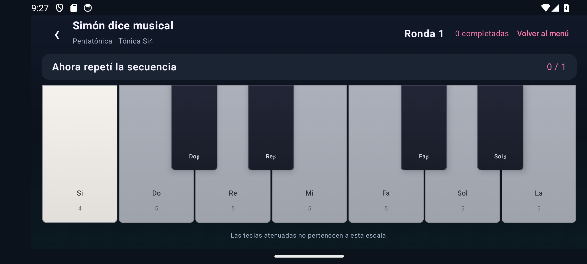
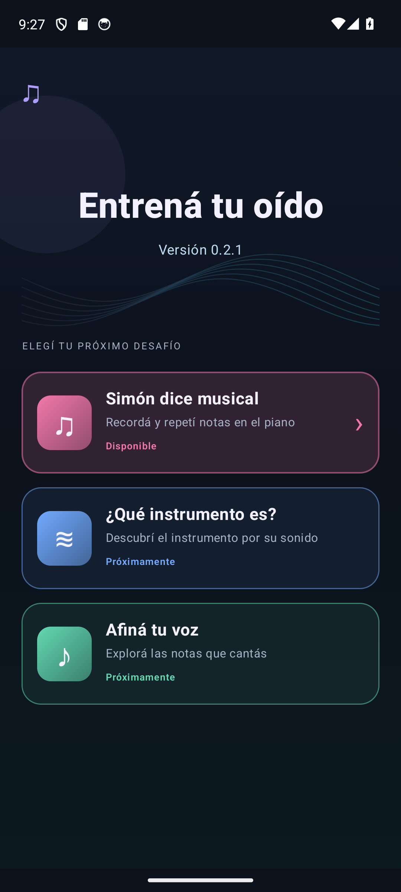
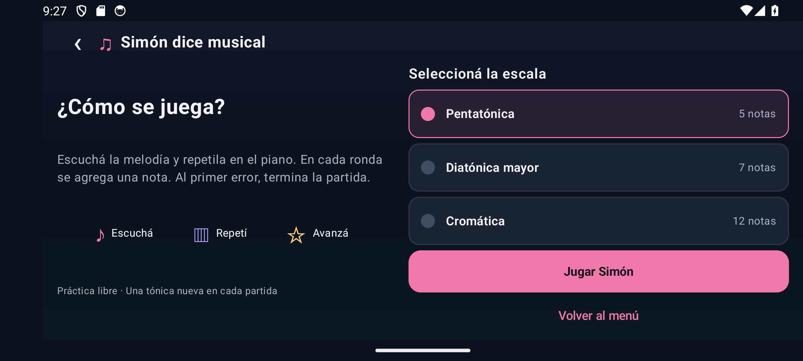

# Neuma

An Android app for musical ear training through serious games, developed as an undergraduate thesis at **Universidad Nacional de Mar del Plata, Argentina**.

Neuma explores how interactive musical exercises, on-device audio processing, and adaptive difficulty can support ear-training practice. The current prototype implements a musical Simon game with a touch piano and offline session history.

**Status:** prototype in development · **Current version:** 0.2.1 · **Platform:** Android 8.0+

## Preview

### Musical Simon

Listen to a sequence, then reproduce it on the piano. Each completed round adds a note; the first incorrect answer ends the session.



<details>
<summary>Main menu and session setup</summary>

<p>
  
</p>



Screenshots show the current Spanish-language interface.

</details>

## Implemented

- **Musical Simon:** sequence playback, note-by-note answers, round progression, and a session summary.
- **Touch piano:** pentatonic, major diatonic, and chromatic scale selection, with sampled piano audio.
- **Responsive note input:** player taps are processed without waiting for the previous sample to finish.
- **Session continuity:** rotating or recreating the screen preserves the current game.
- **Local history:** completed and interrupted sessions are saved as versioned JSON; the menu shows the five most recent sessions.
- **Offline play:** piano samples are bundled with the app. The current game requires neither a network connection nor microphone access.

## Engineering

| Area | Implementation |
| --- | --- |
| Interface | Kotlin, Jetpack Compose, Material 3 |
| State and lifecycle | ViewModel, Kotlin coroutines |
| Game logic | A Kotlin session model independent of Compose |
| Audio | AudioTrack for sequence presentation; preloaded SoundPool samples for player input |
| Persistence | Kotlin serialization and JSON in app-private storage |
| Verification | JVM unit tests, Android instrumented tests, Android Lint |

Game rules, UI state, audio playback, and result storage have separate responsibilities. This lets the sequence and scoring logic be tested without rendering the interface.

The piano bank contains 23 OGG samples. Audio preparation, provenance, and conversion steps are documented in [Piano audio](docs/Audio-piano-Simon.md).

## Run locally

### Requirements

- Android Studio with **Android SDK 36** and **Build Tools 35**.
- **JDK 17 or 21**.
- An emulator or Android device running **API 26 or later**.
- Internet access for the initial dependency download.

### Android Studio

1. Clone the repository:

   ```sh
   git clone https://github.com/SaladinoJC/Neuma-Thesis.git
   ```

2. Open the **`Plataforma/`** directory in Android Studio.
3. Let Gradle sync and configure the Android SDK if prompted.
4. Select the `app` run configuration and a device, then click **Run**.

### Command line

From `Plataforma/`, with your Android SDK configured through Android Studio, `local.properties`, or `ANDROID_HOME`:

```powershell
# Windows PowerShell
.\gradlew.bat :app:assembleDebug
```

```sh
# macOS / Linux
./gradlew :app:assembleDebug
```

The debug APK is generated at `Plataforma/app/build/outputs/apk/debug/app-debug.apk`.

## Tests and validation

From `Plataforma/`:

```powershell
# JVM tests, lint, and debug build
.\gradlew.bat :app:testDebugUnitTest :app:lintDebug :app:assembleDebug

# Instrumented tests: requires a running emulator or connected device
.\gradlew.bat :app:connectedDebugAndroidTest
```

On macOS/Linux, use `./gradlew` instead of `.\gradlew.bat`.

The [v0.2.1 verification record](docs/Verificacion-Simon-v0.2.1.md) reports **11 JVM tests and 8 Android tests passed**, a successful debug build, and lint with **0 errors and 14 warnings**, on a Pixel 6 / API 34 emulator. These are recorded results for that version; physical-device audio validation remains pending.

## Next steps

- Instrument-recognition minigame.
- Explainable dynamic difficulty adjustment using Mamdani fuzzy logic.
- Performance-based level unlocks.
- A separate voice pitch-estimation prototype using YIN.
- Physical-device validation and evaluation of the proposed training approach.

These are planned capabilities. The current prototype does not yet implement adaptive difficulty, instrument recognition, or voice analysis.

## Repository map

```text
Neuma-Thesis/
├── Plataforma/                 Android application and Gradle wrapper
│   ├── app/src/main/           UI, game logic, audio, and persistence
│   ├── app/src/test/           JVM tests
│   ├── app/src/androidTest/    Android instrumented tests
│   └── tools/                  Piano-sample preparation
├── docs/                       Research, specifications, and verification records
│   ├── adr/                    Architecture decisions
│   └── imagenes/               Prototype screenshots
├── CONTEXT.md                  Domain terminology
└── README.md
```

Further documentation, primarily in Spanish:

- [Android development guide](Plataforma/README.md)
- [Prototype specification](docs/Especificacion-prototipo-v1.md)
- [Architecture decisions](docs/adr/)
- [Domain context](CONTEXT.md)

## Credits

Developed by **Juan Cruz Saladino** as an undergraduate thesis at Universidad Nacional de Mar del Plata.

Piano samples originate from the **University of Iowa Electronic Music Studios**. Their provenance and usage terms are recorded in the [audio documentation](docs/Audio-piano-Simon.md).
